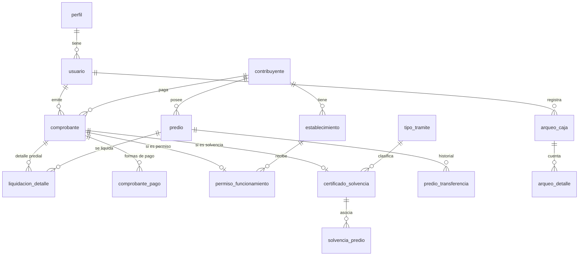

# Modelo de base de datos (propuesta inicial)

Diseño común para los 6 módulos, en **MySQL 8 / MariaDB**. Se revisa en grupo el día 1.
**Emilio crea todas las migraciones**; cualquier cambio se anota aquí primero y se le avisa.
Todas las tablas llevan además `created_at` y `updated_at`. Dinero en `DECIMAL(12,2)`.

## Diagrama entidad-relación

## Tablas

### Seguridad (Módulo 1 · Emilio)
**perfil**: `id`, `nombre` (ADMINISTRADOR / RECAUDADOR / CONTRIBUYENTE), `descripcion`

**usuario**: `id`, `perfil_id`, `nombres`, `correo` (único), `password_hash`, `contribuyente_id` (nullable, solo para el perfil contribuyente), `punto_emision_id`, `estado`

**punto_emision**: `id`, `establecimiento_codigo` (ej. 001), `punto_codigo` (ej. 007), `secuencia_actual`, `descripcion`

### Contribuyentes (Módulo 2 · Karpite)
**contribuyente**: `id`, `pais_origen`, `tipo_contribuyente` (NATURAL/JURIDICA), `tipo_identificacion` (CEDULA/RUC/PASAPORTE), `identificacion` (único), `razon_social`, `representante_legal`, `direccion`, `zona` (URBANA/RURAL), `correo`, `telefono_domicilio`, `celular`, `telefono`, `fecha_nacimiento`, `estado`

> La edad o los años de funcionamiento se calculan a partir de `fecha_nacimiento`; no se guardan.

**establecimiento**: `id`, `contribuyente_id`, `tipo` (FIJO, …), `nombre`, `direccion`, `telefono`, `observaciones`, `estado`

> `pagos_realizados` se calcula con COUNT sobre los comprobantes activos; no se guarda.

**predio**: `id`, `contribuyente_id`, `codigo_catastral` (único), `matricula`, `fecha_escritura`, `fecha_inicio_contribucion`, `zona` (URBANA/RESIDENCIAL/RURAL/INDUSTRIAL), `ubicacion`, `area_m2`, `avaluo_actual`, `observaciones`, `estado` (ACTIVO/INACTIVO/ANULADO/TRANSFERIDO)

**predio_transferencia**: `id`, `predio_id`, `contribuyente_origen_id`, `contribuyente_destino_id`, `fecha`, `usuario_id`, `motivo`

### Recaudación (Módulos 3 a 6)
**comprobante** (Leo, vía `RegistroCobroService`): la cabecera común de todo cobro.
`id`, `tipo` (PREDIAL/SOLVENCIA/PERMISO), `punto_emision_id`, `secuencial`, `fecha_emision`, `contribuyente_id`, `usuario_id`, `valor_total`, `observacion`, `estado` (A/X), `motivo_anulacion`, `anulado_por`, `anulado_en`

**liquidacion_detalle** (Adrian): una fila por año fiscal (RF-20).
`id`, `comprobante_id`, `predio_id`, `anio_fiscal`, `avaluo`, `subtotal`, `porcentaje_descuento`, `valor_descuento`, `total_base`, `intereses`, `multa`, `gastos_administrativos`, `total`

**comprobante_pago** (Leo): formas de pago (RF-22).
`id`, `comprobante_id`, `forma_pago` (EFECTIVO/DEPOSITO/CREDITO/TRANSFERENCIA/CHEQUE_CERTIFICADO/PERMUTA/TARJETA_DEBITO/TARJETA_CREDITO/NOTA_CREDITO), `valor`, `numero_documento`, `banco`

**permiso_funcionamiento** (Santiago): `id`, `comprobante_id`, `establecimiento_id`, `concepto`, `anio_desde`, `anio_hasta`, `direccion_local`

**tipo_tramite** (Erick): catálogo del RF-34. `id`, `nombre`

**certificado_solvencia** (Erick): `id`, `comprobante_id`, `tipo_tramite_id`, `descripcion_tramite` (qué), `a_favor_de`, `leyenda`, `valor` (10.00)

**solvencia_predio** (Erick): `id`, `certificado_id`, `codigo_catastral`, `matricula`

### Caja (Módulo 5 · Santiago)
**arqueo_caja**: `id`, `usuario_id`, `fecha`, `total_contado`, `total_sistema`, `diferencia`

**arqueo_detalle**: `id`, `arqueo_id`, `tipo` (BILLETE/MONEDA), `denominacion`, `cantidad`, `subtotal`

> Los cortes de caja (RF-40 y RF-41) son **consultas** sobre `comprobante` y `comprobante_pago`; no necesitan tablas propias.

## Índices recomendados
`contribuyente.identificacion`, `contribuyente.razon_social`, `predio.codigo_catastral`,
`comprobante(punto_emision_id, secuencial)` único, `comprobante.fecha_emision`, `comprobante.tipo`.
